<p align="center">
  <picture>
    <source media="(prefers-color-scheme: dark)" srcset="docs/logo/wordmark-dark.svg">
    
  </picture>
</p>

**One small doorman in front of your private network.** A self-hosted VPN for developers, QA and CI, shipped as a single Go binary: one open port, one token per person, and every app on your laptop reaches private databases and services as if it were sitting next to them.

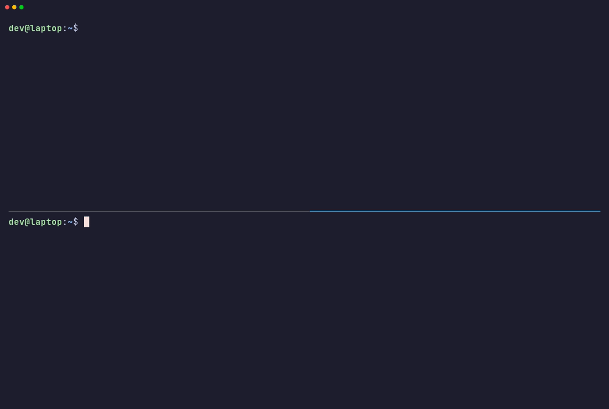

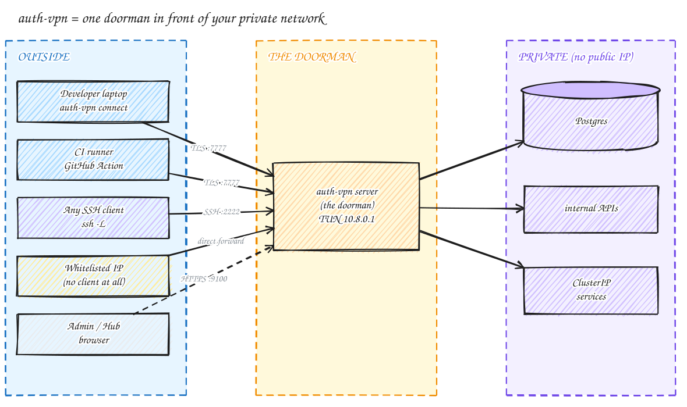

---

## The story in 30 seconds

Your team's Postgres lives on a cloud VM, or inside a Kubernetes cluster, with **no public IP**. That's exactly how the security reviewer wants it. Then someone needs to run a migration from their laptop, and CI needs to seed test data.

The usual answers all hurt:

| Option | Like… | Pain |
|---|---|---|
| Give the database a public IP | leaving the front door open | security says no |
| VNet peering / VPN gateway / bastion | building a new road between two cities | slow, cloud-specific, needs network admins |
| OpenVPN / WireGuard | hiring a security firm | keys, configs, per-device setup |

auth-vpn's answer is **a doorman**. One small program stands next to your private services, and it's the only thing exposed. Anyone with a valid wristband (a token) is walked through a private, encrypted hallway (a TLS 1.3 tunnel) to what they need. Everything else keeps its private IP.

> [!TIP]
> **Recap**
> - The **server** is the doorman, the **tunnel** is the hallway, and **tokens** are the wristbands.
> - Only one port is open on the internet (`7777` by default).
> - It's one binary with no cloud service behind it. You host it.

---

## Quick start

### 1. Server: the machine next to your private services

```bash
curl -fsSL https://github.com/adishM98/auth-vpn/releases/latest/download/install.sh \
  | sudo bash -s -- --server
```

No Go, no Git, nothing to install first. The installer downloads the right binary, generates a self-signed TLS cert, creates a first access token and API key, and registers a systemd service. At the end you'll see:

```
  ─────────────────────────────────────────────
  Connect with:
    auth-vpn connect <server-ip>:7777 --token abc123xyz

  Web dashboard:  https://<server-ip>:9100/ui
  API key:        <generated-key>
  ─────────────────────────────────────────────
```

**That token is shown once.** Store it in a password manager. Then create one token per person (and one for CI) from the dashboard, so you can revoke anyone without affecting the others.

### 2. Client: your laptop (macOS / Linux)

```bash
curl -fsSL https://github.com/adishM98/auth-vpn/releases/latest/download/install.sh | sudo bash

sudo auth-vpn connect <server-ip>:7777 --token <token>                          # foreground
sudo auth-vpn connect <server-ip>:7777 --token <token> --background --reconnect # keep it running

auth-vpn status        # is the tunnel up?
auth-vpn disconnect
```

> [!IMPORTANT]
> Tunnel mode needs **`sudo`**: creating the virtual network card is a root-only operation. Without it you'll see `create tun: … operation not permitted`. No root available? Use [proxy mode](#which-door-should-i-use) instead.

The first time, you're asked to trust the server's certificate fingerprint ("trust on first use"). After that, auth-vpn remembers it and refuses impostors.

Working with several deployments? The first time you connect to one with a token, auth-vpn offers to save it under a name. After that the name is enough, `sudo auth-vpn connect` with no name shows a menu, and connecting to another deployment switches the tunnel over:

```text
$ sudo auth-vpn connect <stage-ip>:7777 --token <token>
Save <stage-ip>:7777 as a profile, so next time it's just `auth-vpn connect <name>`?
Profile name (Enter to skip): stage
  ...
  Saved as profile "stage". Next time: sudo auth-vpn connect stage
```

```bash
sudo auth-vpn connect          # pick from a menu
sudo auth-vpn connect prod     # or by name; stops the stage tunnel first
```

### 3. Use it

Every service on the server machine is now at `10.8.0.1`:

```bash
psql      -h 10.8.0.1 -p 5432
redis-cli -h 10.8.0.1 -p 6379
curl      http://10.8.0.1:8080/health
```

Only `10.8.0.0/24`, plus any routes you or the server add, goes through the tunnel. **Your normal internet traffic is untouched.**

> **Sharing with your team?** [docs/dev-qa-guide.md](docs/dev-qa-guide.md) is a standalone onboarding page for developers and QA. Send it to anyone who needs access.

---

## How it works, in three pictures

### Picture 1: who talks to whom

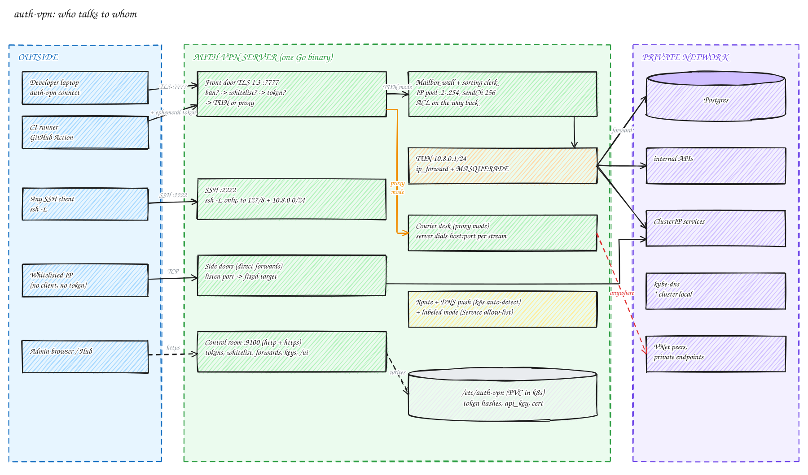

Read it left to right: **outside → the server's rooms → the private network**. The server has one front door (`:7777`, TLS 1.3) plus a few side rooms: an SSH window, side doors for whitelisted IPs, and a control room (the dashboard and API on `:9100`).

### Picture 2: what happens when you connect

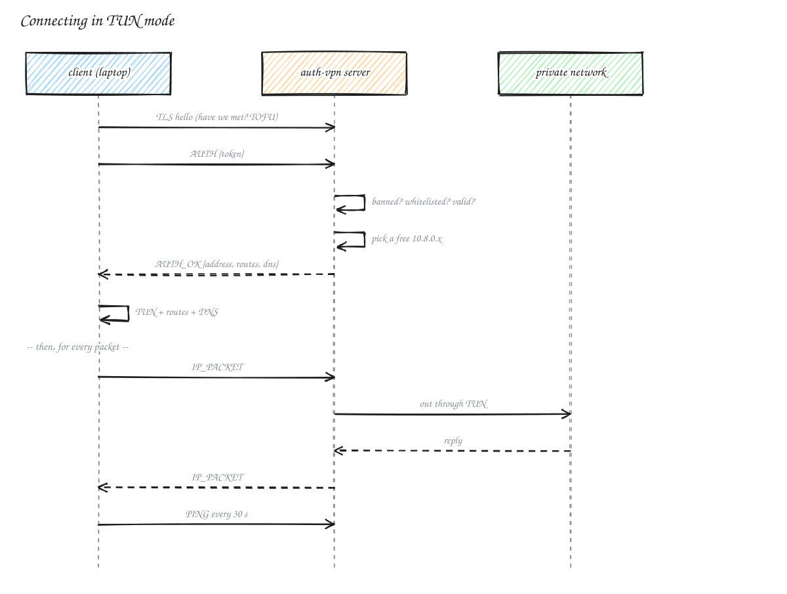

1. **Knock:** TLS handshake, then `AUTH {token}`.
2. **Get a seat:** the server hands out the lowest free address in `10.8.0.2–254`.
3. **Build the hallway:** your laptop creates a virtual network card (TUN) and adds routes. In Kubernetes it also gets the cluster's routes and DNS automatically.
4. **Walk through:** every packet to `10.8.0.x` (or a pushed route) is wrapped in a frame and sent down the tunnel. Replies come back the same way.

### Picture 3: who gets in

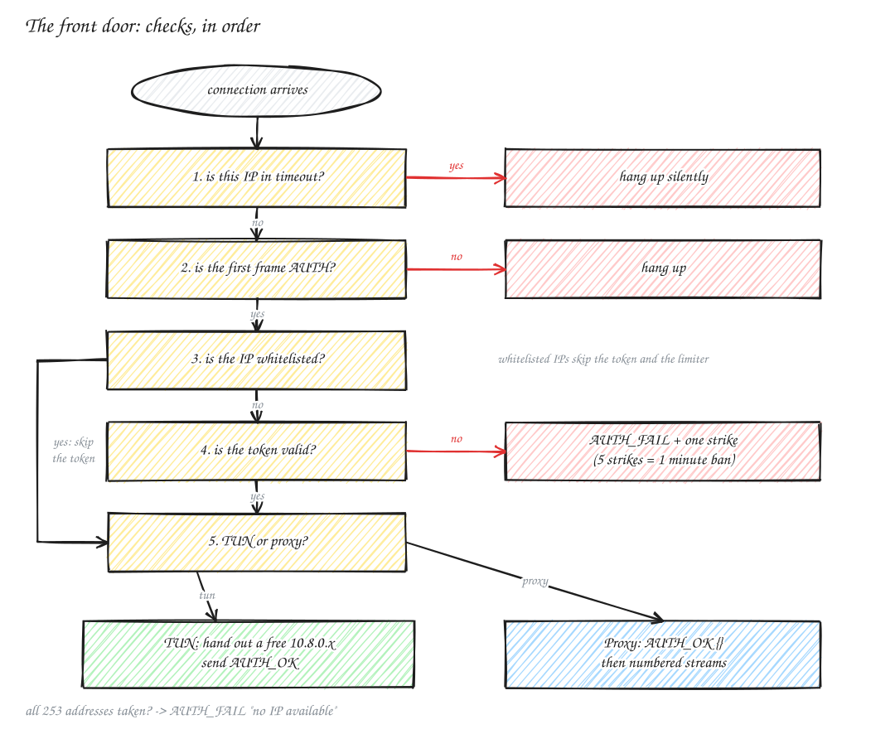

The order matters, like airport security: there's no point reading a boarding pass if the person is on the no-fly list. Five wrong tokens in a minute earns a one-minute timeout.

> [!TIP]
> **Recap**
> - One TLS port in, a `/24` of tunnel addresses, routes only for what you need.
> - Front-door checks: banned? → AUTH? → whitelisted? → token? → TUN or proxy?
> - Deep dive: [docs/architecture.md](docs/architecture.md).

---

## Which door should I use?

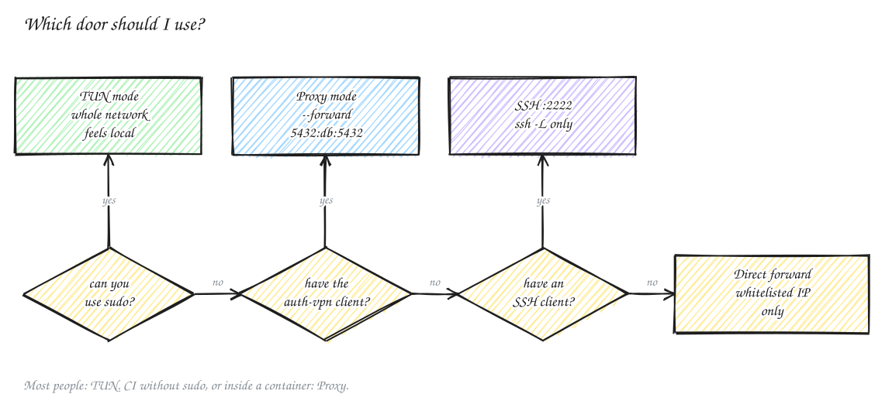

| Door | How | Root on your side? | Reaches |
|---|---|---|---|
| **TUN** (default) | virtual network card; every app just works | yes (`sudo`) | the tunnel subnet, `--route` CIDRs, server-pushed routes |
| **Proxy** | `--forward 5432:10.8.0.1:5432`: local port ↔ remote host:port | no | specific host:port pairs (the server dials them) |
| **SSH** | built-in SSH server on `:2222`, `ssh -L` only | no (any SSH client) | `127.0.0.0/8` and `10.8.0.0/24` on the server |
| **Direct forward** | the server pipes a port to a fixed target | no client at all | what the admin configured, from **whitelisted IPs** only |

```bash
# Proxy mode — no sudo, great for containers and CI
auth-vpn connect <server-ip>:7777 --token <token> --forward 5432:10.8.0.1:5432
psql -h 127.0.0.1 -p 5432
```

---

## Kubernetes: reach cluster services without VNet peering

Run auth-vpn as a pod. It already lives **inside** the cluster network, so your laptop can reach ClusterIP services **by name**, with no VNet peering, no `--route` flags, and no public IP per service.

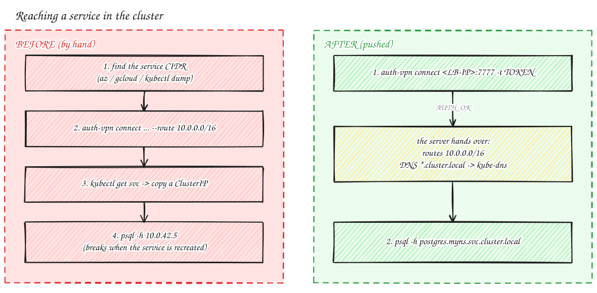

```bash
kubectl apply -k "github.com/adishM98/auth-vpn/k8s?ref=main"   # namespace, read-only RBAC, auth-vpn
kubectl logs -n auth-vpn deploy/auth-vpn | grep "auth-vpn connect"   # first-boot token (shown once)
kubectl get svc -n auth-vpn auth-vpn                                 # LoadBalancer IP

sudo auth-vpn connect <LB-IP>:7777 --token <token>
psql -h postgres.myns.svc.cluster.local            # cluster DNS works through the tunnel
```

On connect, the pod **pushes** two things it detects for you: a route for the cluster's service range, and split DNS for `*.cluster.local`. Your laptop checks what it's handed before using it. It never accepts a default route, anything covering the server's own IP, or a bare TLD, and you can switch it off with `--no-push-routes` / `--no-push-dns`.

### Only some Services: labeled mode

Want **only Grafana** behind the VPN, with everything else exactly as it is?

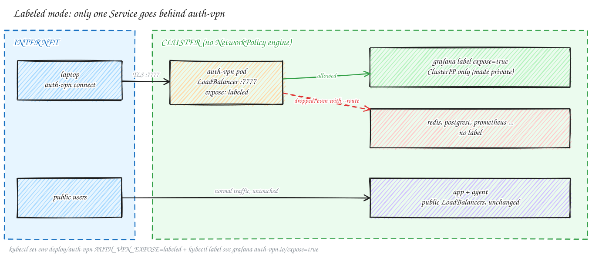

```bash
kubectl set env -n auth-vpn deploy/auth-vpn AUTH_VPN_EXPOSE=labeled
kubectl label svc grafana -n monitoring auth-vpn.io/expose=true
```

auth-vpn then routes and allows **only labelled Services**. It enforces that itself, per packet and per proxy dial, so it works even on clusters with no NetworkPolicy engine. It also fails closed: if the API is unreachable, it keeps the last list.

> [!TIP]
> **Recap**
> - In a cluster, auth-vpn speaks for you (MASQUERADE), so you reach what the pod can reach.
> - Routes and DNS are pushed automatically. Clients need **v2.6.0+**.
> - Labeled mode = an allow-list you manage with `kubectl label`.
>
> Full guide, including the recommended overlay, upgrades and troubleshooting: [docs/k8s-deployment.md](docs/k8s-deployment.md).

---

## The dashboard

Live clients, traffic, tokens, IP whitelist, SSH keys and direct forwards, all on port `9100`, which speaks **both `http://` and `https://`**.


How to reach it:

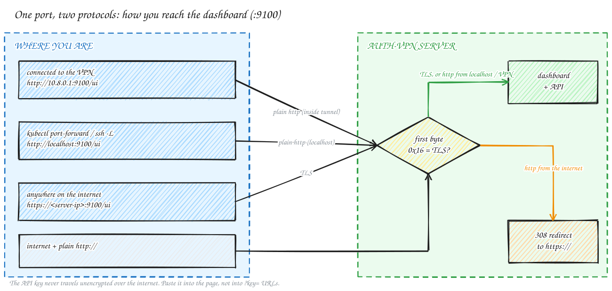

| From | Open |
|---|---|
| a connected VPN client | `http://10.8.0.1:9100/ui` |
| the server, `ssh -L 9100:localhost:9100`, or `kubectl port-forward` | `http://localhost:9100/ui` |
| anywhere else | `https://<server-ip>:9100/ui` (self-signed cert) |

Plain `http://` from the internet is redirected to `https://`, so the API key never crosses the internet unencrypted. Paste the key into the page rather than into `?key=` URLs. Prometheus metrics are at `/metrics`:

```
auth_vpn_uptime_seconds        auth_vpn_active_connections
auth_vpn_connections_total     auth_vpn_auth_failures_total
auth_vpn_bytes_in_total        auth_vpn_bytes_out_total
auth_vpn_dropped_packets_total
```

---

## GitHub Actions

Two steps per job. Every job gets **its own short-lived token**, created at the start and revoked at the end, so parallel matrix jobs never share credentials.

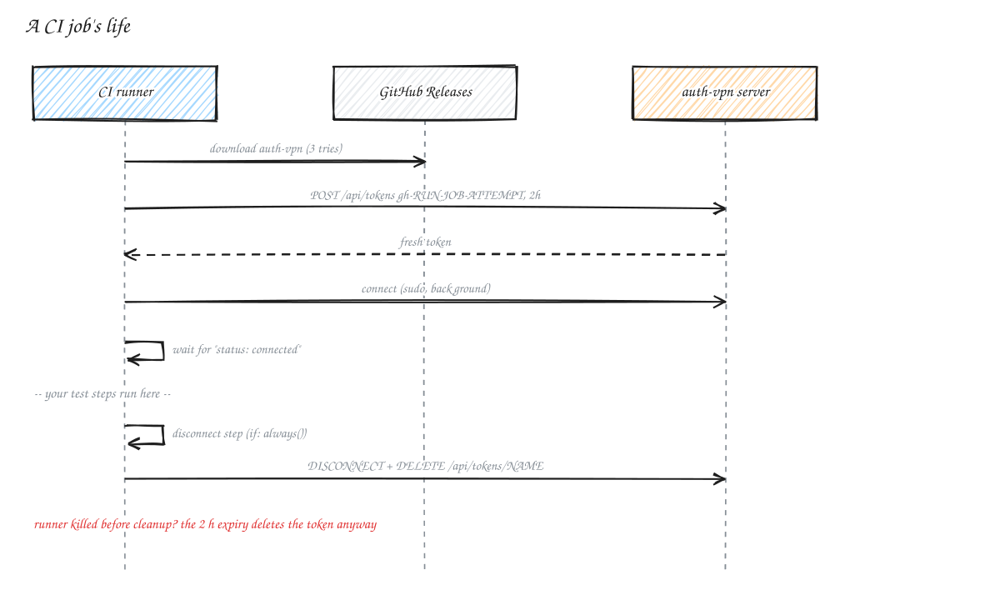

```yaml
steps:
  - name: Connect to VPN
    uses: adishM98/auth-vpn@v2
    with:
      server: ${{ secrets.VPN_SERVER }}            # <server-ip>:7777
      api-key: ${{ secrets.VPN_API_KEY }}          # api_key from /etc/auth-vpn/server.yaml
      api-url: https://<server-ip>:9100

  # services on the server are now at 10.8.0.1 (or by name, if the server runs in Kubernetes)

  - name: Disconnect VPN
    if: always()
    uses: adishM98/auth-vpn/disconnect@v2
```

More: [docs/github-actions.md](docs/github-actions.md) (matrix jobs, proxy mode, inputs, non-GitHub CI).

---

## Many servers? The hub

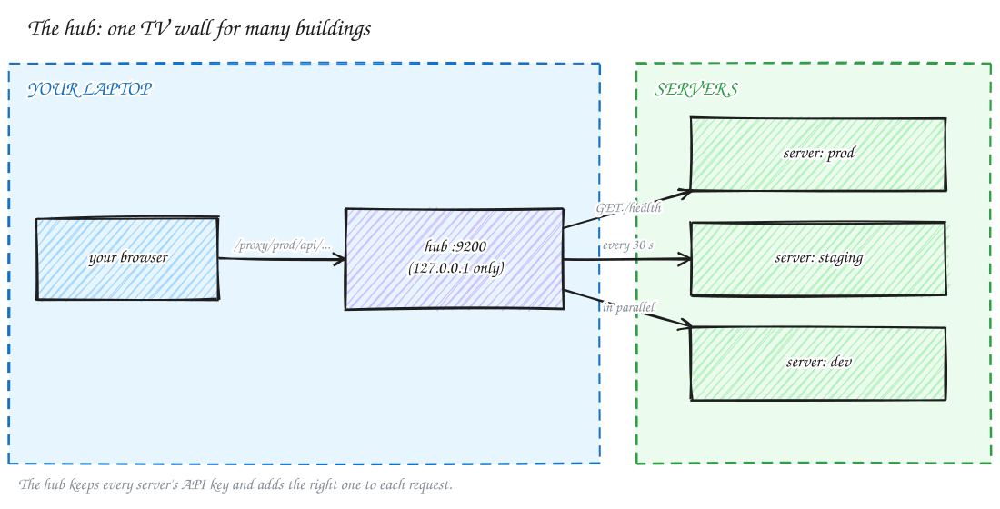

`auth-vpn hub serve` gives you one local dashboard over every server (prod, staging, eu-west…), using each server's API key. See [docs/hub.md](docs/hub.md).

---

## Security model

- **TLS 1.3** tunnel, with the server's self-signed cert **pinned on first use** (TOFU). A changed cert is refused.
- **Tokens:** only a SHA-256 hash is stored on the server. Tokens can be permanent, expiring or one-time. Revoking one blocks new connections immediately, and **Kick** (dashboard) ends a live session.
- **Rate limiting:** 5 failed auths in a minute → 60-second ban for that IP.
- **Ephemeral CI tokens:** one per job, revoked on exit, with a 2-hour expiry as a backstop.
- **ACL rules:** per-device allow/deny by protocol and port (optional).
- **Kubernetes labeled mode:** only labelled Services are reachable. It's enforced by the server and fails closed.
- **Pushed settings are filtered client-side:** no default route, nothing covering the server IP, no bare TLDs.
- **API key** for the dashboard and API. It's never sent unencrypted over the internet.
- **IP whitelist, direct forwards and SSH tunnel** are there for machines that can't run the client.

---

## Install options

```bash
URL=https://github.com/adishM98/auth-vpn/releases/latest/download/install.sh

curl -fsSL $URL | sudo bash                              # client
curl -fsSL $URL | sudo bash -s -- --server               # server, port 7777
curl -fsSL $URL | sudo bash -s -- --server --port=8888   # server, another port
curl -fsSL $URL | sudo bash -s -- --version=v2.9.0       # pin a release (add to any line)
```

Piped installs never prompt, so the port is 7777 unless you pass `--port=<n>` or set `TJ_VPN_PORT`. To be asked for the port, run `./install.sh --server` from a clone.

**Deploy from your Mac** (the VM needs nothing): `make deploy VM=azureuser@<vm-ip>` for a server, `make deploy-client VM=…` for a client.

**Docker Compose:** containers must publish on `0.0.0.0` (`"5432:5432"`), not `127.0.0.1:5432:5432`, or the tunnel can't reach them.

### Build from source

Requires **Go 1.25+**.

```bash
git clone https://github.com/adishM98/auth-vpn && cd auth-vpn
go build -o auth-vpn ./cmd     # current platform
make build-all                 # linux/amd64, darwin/amd64, darwin/arm64 → dist/
```

| Make target | What it does |
|---|---|
| `make build-linux` / `build-mac-arm` / `build-mac-intel` / `build-all` | build into `dist/` |
| `make install` / `make install-server` | install client / server on this machine |
| `make deploy VM=user@host` / `make deploy-client VM=user@host` | build and install on a remote VM |
| `make release` | build all + publish a GitHub release |
| `make clean` | remove `dist/` |

### Updating

```bash
sudo auth-vpn update     # latest release; restarts the systemd service if active
auth-vpn version
sudo auth-vpn server change-port   # move the tunnel port (update firewalls + client profiles too)
```

Re-running the server installer is safe: it keeps `server.yaml`, the TLS cert and all tokens.

### Uninstalling

```bash
# client
auth-vpn disconnect && sudo rm /usr/local/bin/auth-vpn && rm -rf ~/.auth-vpn

# server
sudo systemctl disable --now auth-vpn
sudo rm -f /usr/local/bin/auth-vpn /etc/systemd/system/auth-vpn.service /var/run/auth-vpn.sock
sudo rm -rf /etc/auth-vpn && sudo systemctl daemon-reload
```

---

## Read next

| If you want to… | Read |
|---|---|
| understand how it works inside (frames, front door, packet path) | [docs/architecture.md](docs/architecture.md) |
| run it in Kubernetes, with labeled mode | [docs/k8s-deployment.md](docs/k8s-deployment.md) |
| use the dashboard, API, whitelist, direct forwards, SSH | [docs/server-features.md](docs/server-features.md) |
| look up a command or setting | [docs/cli-reference.md](docs/cli-reference.md) |
| wire up CI | [docs/github-actions.md](docs/github-actions.md) |
| manage many servers | [docs/hub.md](docs/hub.md) |
| onboard a developer / QA | [docs/dev-qa-guide.md](docs/dev-qa-guide.md) |
| step-by-step VM install | [INSTALL.md](INSTALL.md) |

The demo clips are recorded in throwaway containers; [`docs/demo/`](docs/demo) has the scripts to re-record them. All diagrams are in [`docs/diagrams/`](docs/diagrams): an `.svg` for reading and an `.excalidraw` for editing. To redraw them: `cd docs/diagrams/_src && npm install && npm run build`.
