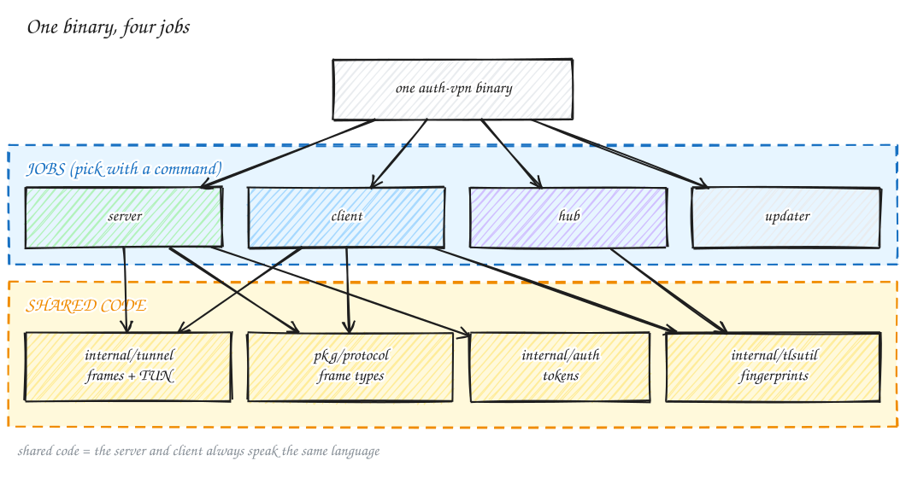
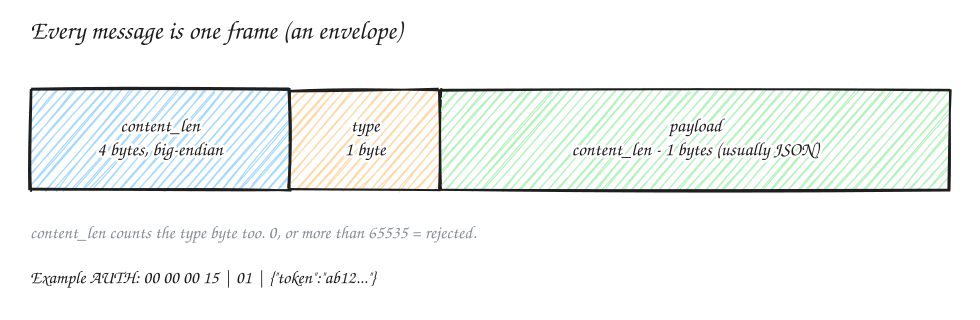
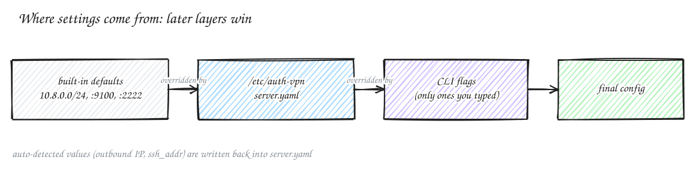
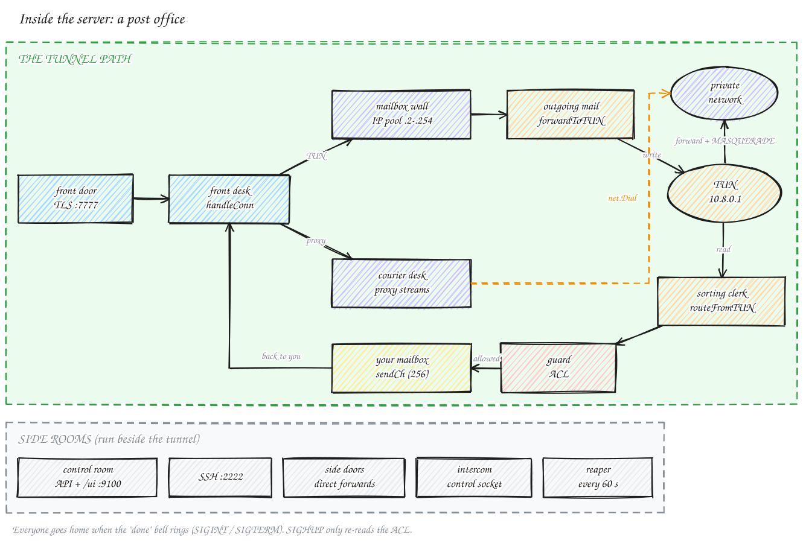
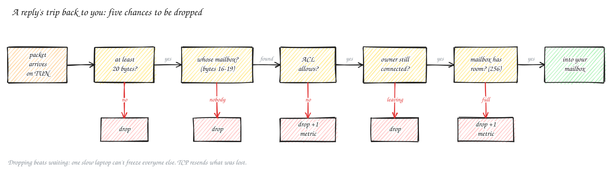
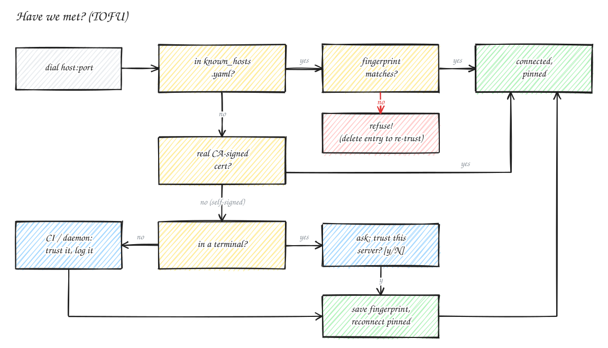
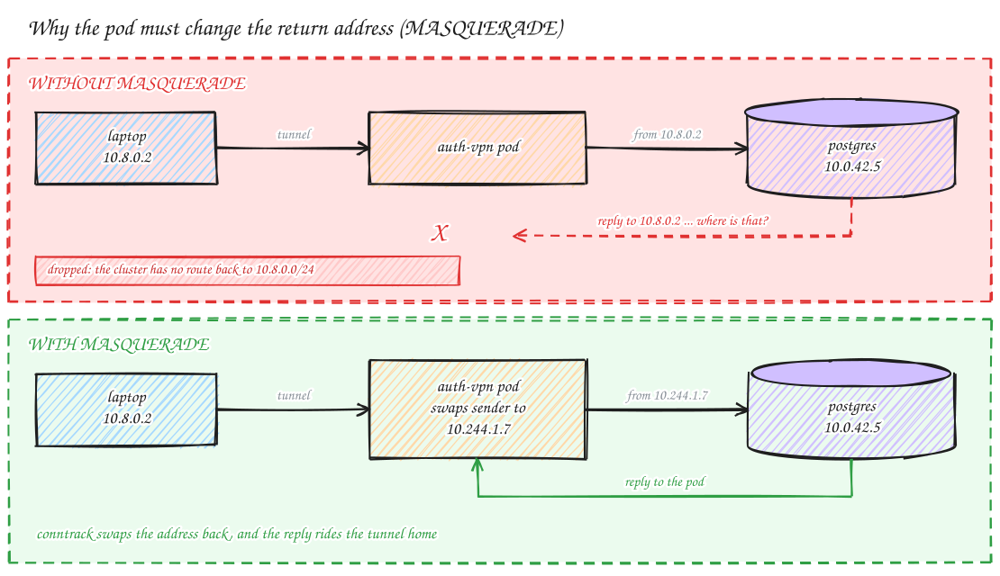
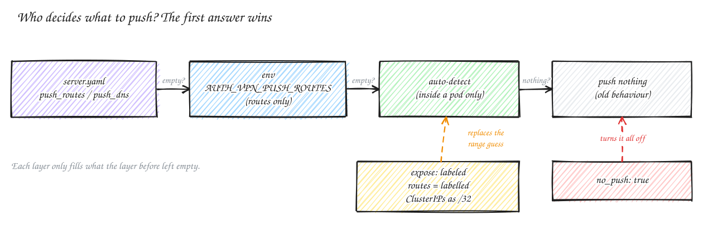
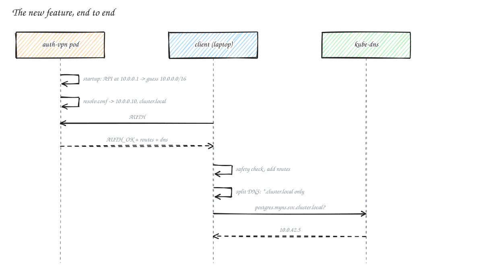
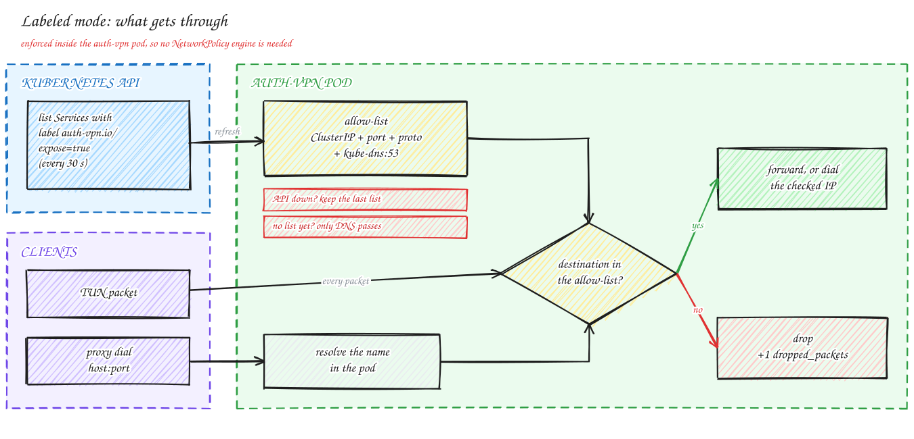

# How auth-vpn works

← [README](../README.md)

A tour of the inside, one picture at a time. Each section starts with an everyday analogy, shows a diagram, and then gives the real names. If you only have five minutes, look at the pictures and read the **Recap** boxes.

---

## 1. One binary, four jobs

Like a Swiss Army knife, the same `auth-vpn` file does four different jobs, depending on the command you type.

| Command | Job |
|---|---|
| `auth-vpn server …` | the doorman: tunnel, dashboard/API, SSH, side doors |
| `auth-vpn connect …` | the client on a laptop or CI runner |
| `auth-vpn hub serve` | one dashboard over many servers |
| `auth-vpn update` | replaces itself with the latest release |

The jobs share code for the wire format (`pkg/protocol`, `internal/tunnel`), tokens (`internal/auth`) and certificate fingerprints (`internal/tlsutil`). That's why a client and server of the same version always understand each other.

---

## 2. The whole building

Three zones, read left to right:
- **Outside:** laptops, CI runners, SSH clients, whitelisted machines, the admin's browser.
- **The server:** the only thing with a public port. It has a front door (`:7777`), side rooms (SSH `:2222`, direct forwards, the control room `:9100`) and its state on disk (`/etc/auth-vpn`).
- **Private network:** whatever the server can reach. On a VM that's the VM's own services at `10.8.0.1`. In Kubernetes, it's ClusterIPs, pods and peered networks.

---

## 3. Envelopes: the wire format

A TLS connection is a pipe of bytes with no gaps. To send *separate messages* through it, every message goes in an envelope that says how big it is. auth-vpn calls the envelope a **frame**:

The reader takes 4 bytes (the length), rejects `0` or anything over 65,535, reads that many bytes, and treats the first byte as the **type**:

| Type | Name | Sent by | Payload |
|---|---|---|---|
| `0x01` | AUTH | client | `{"token","mode"}` |
| `0x02` | AUTH_OK | server | `{"client_ip","server_ip","subnet","routes"?,"dns"?}` |
| `0x03` | AUTH_FAIL | server | `{"reason"}` |
| `0x04` | IP_PACKET | both | a raw IPv4 packet |
| `0x05` / `0x06` | PING / PONG | both | — |
| `0x07` | DISCONNECT | both | — |
| `0x08` | PROXY_DIAL | client | `{"stream_id","host","port"}` |
| `0x09` / `0x0A` | PROXY_OK / PROXY_FAIL | server | `{"stream_id"(,"reason")}` |
| `0x0B` | PROXY_DATA | both | `[4-byte stream id][bytes]` |
| `0x0C` | PROXY_CLOSE | both | `[4-byte stream id]` |

> [!NOTE]
> **Why adding fields never breaks old versions:** payloads are JSON, Go's decoder ignores unknown fields, and `omitempty` leaves out empty ones. A new server can add `routes`: old clients don't notice, and new clients talking to an old server just get nothing. No protocol version number is needed.

---

## 4. The front door

Like airport security, each check can turn you away, and the order matters:

1. **Banned IP?** 5 wrong tokens in a minute → 1-minute timeout. Hang up before reading anything.
2. **First frame is AUTH?** Otherwise hang up.
3. **Whitelisted IP?** Walk in under the whitelist name. No token is checked, and the limiter doesn't apply.
4. **Valid token?** Hash it, look it up, check expiry and one-time use. A wrong token gets `AUTH_FAIL` plus a strike.
5. **TUN or proxy?** TUN gets the lowest free address in `10.8.0.2–254` (253 max). Proxy gets numbered streams.

Settings come in three layers, and a later layer wins:

---

## 5. Inside the server: a post office

| Room | Real name | What it does |
|---|---|---|
| front desk | `handleConn` | checks the wristband, hands out a mailbox number (`10.8.0.x`) |
| outgoing mail | `forwardToTUN` (one per client) | writes your packets to the TUN device. In labeled mode, checks each one first |
| sorting clerk | `routeFromTUN` (one goroutine) | reads each reply's destination (bytes 16–19) and drops it in the right mailbox |
| your mailbox | `sendCh`, 256 slots | replies waiting to go to you |
| guard | ACL | optional per-device allow/deny on replies |
| courier desk | proxy mode | dials `host:port` per stream, `PROXY_DATA` back and forth |
| side rooms | API `:9100`, SSH `:2222`, direct forwards, control socket, reaper | run beside the tunnel |

### A reply's trip back to you

One sorting clerk serves **every** client. If your mailbox is full (say you're on bad hotel Wi-Fi), the clerk drops your packet instead of waiting, so one slow laptop can't freeze everyone else. TCP on your laptop notices the gap and resends.

### Keeping the hallway lit

- **Heartbeat:** the client pings every **30 s**. If its 5-second ticker sees a gap over **20 s**, the laptop was asleep, so it pings immediately.
- **Reaper:** every **60 s**, the server closes connections that have been silent for over **3 minutes**.

> [!TIP]
> **Recap**
> - Frame = 4-byte length + 1-byte type + payload (≤ 65,535 bytes).
> - Front door: banned → AUTH → whitelist → token → TUN or proxy.
> - One clerk routes every reply, and drops rather than waits.

---

## 6. The client side

### What did you mean?

### Have we met? (TOFU)

The first time you meet the doorman, you memorize their face. Next time, if a different face is at the door, you walk away.

- **The fingerprint** is `SHA256:` + base64(sha256(cert)).
- **Where it's stored:** `~/.auth-vpn/known_hosts.yaml`, keyed by the exact `host:port` you typed.
- **On a mismatch** the client refuses to connect. Delete the line to trust the server again, but only if you know why the cert changed (for example, a fresh install).

### Routes and DNS the server pushes

In Kubernetes, `AUTH_OK` also carries `routes` and `dns`. The client **checks** them before applying anything:

| Rejected | Example | Why |
|---|---|---|
| not IPv4 | `fd00::/8` | the tunnel is IPv4 |
| broader than `/8` | `0.0.0.0/0` | would send *all* your traffic to the server |
| covers the server's own IP | `20.30.0.0/16` when the server is `20.30.40.50` | the tunnel would try to travel through itself |
| bad domain | `com`, `../etc/passwd` | a whole TLD, or a path outside `/etc/resolver` |

Accepted DNS settings become split DNS. On macOS that's `/etc/resolver/<domain>`; on Linux, `resolvectl ~<domain>` on the tunnel interface. Everything is undone on disconnect. Don't want any of it? Use `--no-push-routes` and `--no-push-dns`.

---

## 7. Kubernetes: why it "just reaches everything"

Without MASQUERADE, replies go to `10.8.0.x`, which the cluster has never heard of. With it, the pod puts **its own** address on outgoing packets, and conntrack swaps it back for the reply. Anything the pod can reach, you can reach. That's why you don't need VNet peering.

### What the pod pushes, and who decides

### Labeled mode: an allow-list you manage with labels

Every 30 s the pod lists Services labelled `auth-vpn.io/expose=true` (with list-only RBAC). It pushes one `/32` per labelled ClusterIP, and **drops** every client packet or proxy dial that isn't headed to a labelled Service, kube-dns `:53`, or its own dashboard port. It fails closed: when the API is down it keeps the last list, and with no list yet only DNS passes.

Guide: [k8s-deployment.md](k8s-deployment.md).

---

## 8. The dashboard port: one port, two protocols

`:9100` looks at the **first byte** of each connection. `0x16` is a TLS handshake, so it's handled as https. Anything else is plain http, which is served only to localhost and the VPN subnet. From anywhere else, plain http gets a `308` redirect to https.

---

## Design decisions

| Choice | Why | What it costs |
|---|---|---|
| **TLS 1.3 over TCP**, not UDP/WireGuard | passes every proxy, load balancer and firewall | TCP-in-TCP slows down on lossy links (fine for dev/CI) |
| **One binary** | `scp` it anywhere, no runtime deps | needs `ip`/`ifconfig`/`iptables` on the host |
| **One TUN, a `/24`, a map lookup** | dead simple, O(1) routing | 253 clients max, IPv4 only |
| **Drop instead of block** when a client's queue is full | one slow client can't freeze others | that client loses packets (TCP resends) |
| **TOFU** instead of a CA | zero setup | the first connection must be trusted |
| **Split tunnel** | only the tunnel subnet + routes go through it | you add routes for anything else (or Kubernetes pushes them) |
| **Tokens stored as SHA-256** | a stolen `tokens.yaml` can't be replayed | a lost token can't be recovered, only replaced |
| **Labeled mode enforced in the server**, not the cluster | works where NetworkPolicy isn't enforced | the server must see every packet (it already does) |
