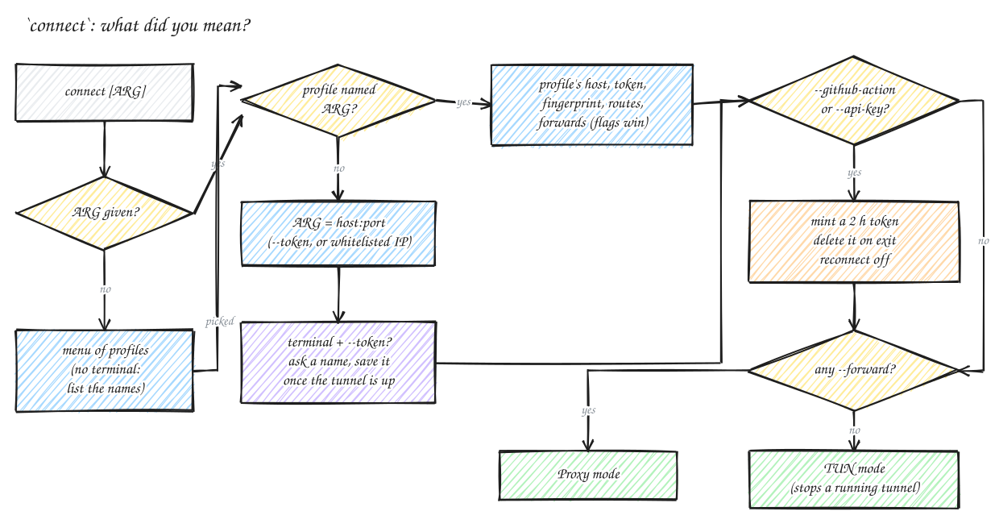

# CLI Reference

← [README](../README.md)

How `auth-vpn connect` decides what you meant, before it touches the network:



> [!IMPORTANT]
> Tunnel (TUN) mode needs `sudo`: creating the virtual network card is root-only. Proxy mode (`--forward`) doesn't.

## Server

```bash
# Install + configure (run once per VM — prompts for tunnel port)
sudo auth-vpn server install

# Install with a specific port (skips the prompt)
sudo auth-vpn server install --port 8888

# Change the tunnel port after installation (prompts for new port, restarts service)
sudo auth-vpn server change-port

# Start the server (systemd handles this automatically after install)
sudo auth-vpn server start

# Start with custom settings (overrides server.yaml)
sudo auth-vpn server start --subnet 10.8.0.0/24 --server-ip 10.8.0.1
sudo auth-vpn server start --metrics-addr 0.0.0.0:9100 --api-key <key>
sudo auth-vpn server start --acl /etc/auth-vpn/acl.yaml

# Routes / split DNS pushed to TUN clients — set in /etc/auth-vpn/server.yaml.
# Inside Kubernetes these are auto-detected when unset; AUTH_VPN_PUSH_ROUTES env overrides the route guess.
#   push_routes: [10.0.0.0/16]
#   push_dns: {server: 10.0.0.10, domains: [cluster.local]}
#   no_push: true            # disable pushing + auto-detection
#   expose: labeled          # only Services labelled auth-vpn.io/expose=true are reachable (env: AUTH_VPN_EXPOSE)

# See who is currently connected
sudo auth-vpn server clients

# Token management
auth-vpn server tokens list
auth-vpn server tokens add --name "dev-alice"
auth-vpn server tokens add --name "ci-runner"   --expires 24h
auth-vpn server tokens add --name "temp"        --one-time
auth-vpn server tokens revoke --name "dev-alice"
```

## Client

```bash
# Connect interactively (Ctrl+C to disconnect)
sudo auth-vpn connect <server-ip>:7777 --token <token>

# Connect using a saved profile (no name: pick from a menu)
sudo auth-vpn connect staging

# Background mode (survives terminal close)
sudo auth-vpn connect staging --background

# Background + auto-reconnect on unexpected drop (exponential backoff, max 2 min)
sudo auth-vpn connect staging --background --reconnect

# Wait until server is reachable before connecting (useful in CI)
sudo auth-vpn connect staging --background --wait

# Route additional CIDRs through the tunnel (e.g. k8s service subnet)
sudo auth-vpn connect staging --route 10.0.0.0/16

# Ignore routes / split DNS the server pushes (e.g. auto-detected k8s service CIDR + *.cluster.local)
sudo auth-vpn connect staging --no-push-routes
sudo auth-vpn connect staging --no-push-dns

# GitHub Actions: auto-mint a unique ephemeral token per job (reads AUTH_VPN_API_KEY env var)
# Run with & so the step doesn't block; use `auth-vpn disconnect` at the end to revoke the token
auth-vpn connect $VPN_HOST --github-action --forward 5432:localhost:5432 &

# Check tunnel status
auth-vpn status

# Disconnect background tunnel
auth-vpn disconnect
```

## Proxy mode (no TUN device, no root required)

Use `--forward` instead of a TUN tunnel. auth-vpn binds a local port and forwards all TCP traffic through the encrypted tunnel to the remote host:port. Works anywhere — Docker containers, Render, Railway, Cloud Run, CI runners.

```bash
# Forward local 5432 → postgres on the VM, local 6379 → redis on the VM
sudo auth-vpn connect <server-ip>:7777 --token <token> \
  --forward 5432:10.8.0.1:5432 \
  --forward 6379:10.8.0.1:6379 \
  --background --reconnect

# Multiple forwards, background + auto-reconnect
sudo auth-vpn connect staging \
  --forward 5432:10.8.0.1:5432 \
  --forward 3306:10.8.0.1:3306 \
  --forward 27017:10.8.0.1:27017 \
  --background --reconnect
```

Point your app at `127.0.0.1:<localPort>` — it connects as if the service is local. No routing table changes, no kernel privileges needed.

> **Common mistake — port already in use locally**
> If you run the same service on your machine (e.g. a local Postgres on `5432`), binding `--forward 5432:...` will fail because that port is taken. Use a different local port instead:
> ```bash
> --forward 15432:10.8.0.1:5432   # local 15432 → remote 5432
> ```
> Then point your app at `127.0.0.1:15432`.

## Profiles

A profile is one deployment saved under a name: server address, token, certificate fingerprint, and optionally extra routes or proxy forwards. Save each deployment once, then connect by name.

```bash
# Save (port defaults to 7777). Re-running add changes only the flags you pass.
auth-vpn profile add stage <server-ip> --token <token> --fingerprint SHA256:...
auth-vpn profile add prod-db <server-ip>:7777 --token <token> --forward 15432:10.8.0.1:5432
auth-vpn profile add stage --token <new-token>      # after a token rotation

auth-vpn profile list                               # ● marks the connected one
auth-vpn profile rm prod-db

sudo auth-vpn connect                               # menu of saved profiles
sudo auth-vpn connect stage                         # by name
```

```
Saved deployments

  #  NAME     SERVER              MODE                 CERTIFICATE  STATUS
  1  stage    203.0.113.10:7777   tun                  pinned       ● connected
  2  prod-db  198.51.100.7:7777   proxy, 1 forward(s)  pinned

Connect to [1-2 or name]:
```

- **Switching:** only one tunnel-mode connection runs at a time, because every server hands out the same `10.8.0.0/24` by default. Connecting to another profile stops the running tunnel first and prints `switched stage → prod`. Proxy-mode connections don't touch routes, so they keep running. A tunnel started by an auth-vpn from before profiles (which kept no state) is found from the process list, so `status`, `disconnect` and switching handle it too.
- **Flags win:** `--token` and `--forward` given on the command line override the profile for that run; `--route` adds to its routes.
- **Fingerprint:** the `SHA256:...` value the trust prompt shows on first connect (ask your admin for it). With it in the profile, auth-vpn checks the server against it and never asks; it replaces any earlier trust answer for that address.
- **sudo:** profiles and trusted fingerprints are kept in your own `~/.auth-vpn`, also when you run `sudo auth-vpn connect`. `auth-vpn status` and `profile list` work without sudo.
- **Scripts:** without a terminal, `auth-vpn connect` with no name refuses to guess and lists the profile names.
- `profile save <name> --host <h> --token <t>` still works (it's an alias of `add`).

## Hub

```bash
# Start the hub dashboard (default: http://127.0.0.1:9200)
auth-vpn hub serve

# Custom port or bind address
auth-vpn hub serve --port 9300
auth-vpn hub serve --port 9300 --bind 0.0.0.0
```

Config is stored at `~/.auth-vpn/hub.yaml`. Add and remove servers from the UI — no manual YAML editing needed. See [hub.md](hub.md) for full documentation.

## Other

```bash
# Check installed version
auth-vpn version

# Update binary in-place (restarts systemd service on server)
sudo auth-vpn update
```

## Environment variables

| Variable | Used by | Effect |
|---|---|---|
| `AUTH_VPN_PORT` | Docker/k8s entrypoint | tunnel port for the first-boot install (default `7777`) |
| `AUTH_VPN_EXPOSE` | server | `all` (default) or `labeled`: only Services labelled `auth-vpn.io/expose=true` are reachable (same as `expose:` in `server.yaml`) |
| `AUTH_VPN_PUSH_ROUTES` | server | comma-separated CIDRs pushed to clients; overrides the auto-detected service CIDR (`push_routes:` in `server.yaml` wins over it) |
| `AUTH_VPN_API_KEY` | `connect --github-action` | API key used to mint the per-job ephemeral token |
